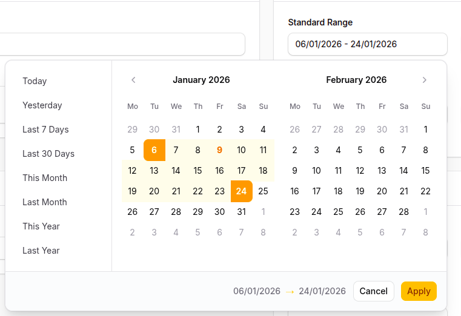
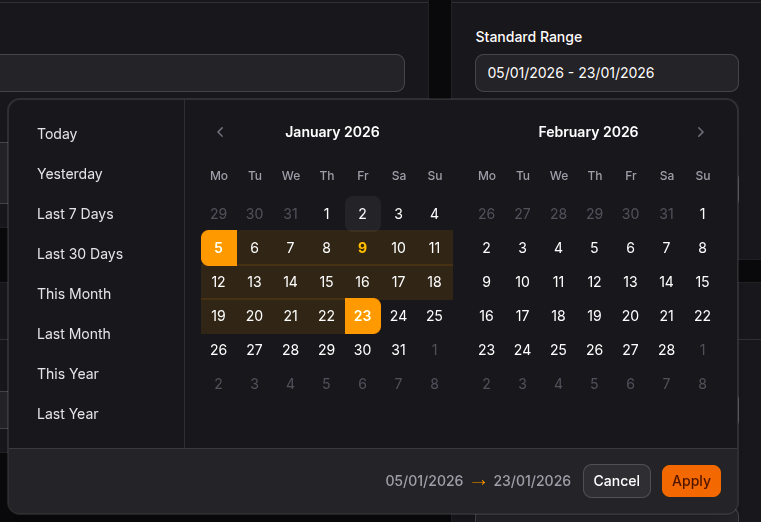

# Filament Date Range Picker and Filter

[](https://packagist.org/packages/malzariey/filament-daterangepicker-filter)
[](https://packagist.org/packages/malzariey/filament-daterangepicker-filter)

A native Alpine.js date range picker for [Filament](https://filamentphp.com/). Select date ranges, months, or years with support for presets, time selection, and full modal/slide-over compatibility.

## Features

- 🗓️ **Day, Month, or Year Picker** - Choose the granularity that fits your needs
- ⌨️ **Keyboard Input Support** - Type dates directly with format validation
- 🎯 **Modal Compatible** - Dropdown teleports to body, solving z-index issues
- 🕐 **Time Picker** - Optional time selection with 12/24 hour format
- 🌍 **Localization** - Full i18n support via Day.js locales
- ♿ **Accessible** - Keyboard navigation and ARIA attributes
- 🎨 **Native Filament UI** - Seamlessly matches Filament v4 styling

## Installation

```bash
composer require malzariey/filament-daterangepicker-filter
```

Publish translations (optional):

```bash
php artisan vendor:publish --tag="filament-daterangepicker-filter-translations"
```

## Screenshots

#### Light mode


#### Dark mode


## Basic Usage

### As a Field
```php
use Malzariey\FilamentDaterangepickerFilter\Fields\DateRangePicker;

DateRangePicker::make('created_at'),
```

### As a Filter
```php
use Malzariey\FilamentDaterangepickerFilter\Filters\DateRangeFilter;

DateRangeFilter::make('created_at'),
```

---

## Picker Type Modes

### Day Picker (Default)
Select specific dates:

```php
DateRangePicker::make('date_range')
    ->format('d/m/Y');
```

### Month Picker
Select entire months. The popup header includes previous/next-year buttons and a compact numeric year input, so users can jump to a year without stepping one year at a time.

```php
use Malzariey\FilamentDaterangepickerFilter\Fields\DateRangePicker;

DateRangePicker::make('billing_period')
    ->monthPicker()
    ->format('F Y');
```

Month picker mode also supports typed input. Pressing Enter applies the typed month value without falling through to day-picker selection behavior:

```php
DateRangePicker::make('billing_period')
    ->monthPicker()
    ->singleCalendar()
    ->allowInput()
    ->format('m/Y');
```

Range input works with the configured separator:

```php
DateRangePicker::make('billing_period')
    ->monthPicker()
    ->allowInput()
    ->format('m/Y');
```

Example input:

```text
06/2026 - 08/2026
```

Month picker year options and disabled months respect `minYear()`, `maxYear()`, `minDate()`, and `maxDate()`:

```php
DateRangePicker::make('billing_period')
    ->monthPicker()
    ->format('m/Y')
    ->minYear(2020)
    ->maxYear(2030)
    ->minDate('2020-06-01')
    ->maxDate('2030-12-31');
```

### Year Picker
Select entire years:

```php
DateRangePicker::make('fiscal_years')
    ->yearPicker()
    ->format('Y')
    ->minYear(2020)
    ->maxYear(2030);
```

---

## New Features

### Keyboard Input
Allow users to type dates directly:

```php
DateRangePicker::make('dates')
    ->allowInput(); // Enable keyboard entry with format validation
```

When `allowInput()` is enabled, pressing Enter while focused inside the input parses and applies the typed value first. Invalid partial input does not overwrite the previous valid selection unless the user clears the field.

A field cleared in the browser (deleting the text, or the picker's own clear) stores an empty string `''`; the Clear action stores `null`. Both mean "no range": the filter ignores either, and `required()` fails on either. **6.0 will store `null` for every clear**, so a `string $state` type in `afterStateUpdated()` or a `NOT NULL` string column should accept `null` by then.

### Modal & Slide-Over Compatibility
The dropdown teleports to `<body>` by default to avoid z-index issues:

```php
DateRangePicker::make('dates')
    ->teleport();      // Enabled by default

DateRangePicker::make('dates')
    ->teleport(false); // Render the dropdown in place, inside the field
```

With `teleport(false)` the dropdown is rendered inside the field's own wrapper and positioned against it (`position: absolute`), so it scrolls with the field and stays inside the modal or slide-over that holds it. Clicking outside, tabbing away, Escape and the time picker's focus inside a modal work the same either way. The limit is clipping: an ancestor with `overflow: hidden`, `auto` or `scroll` (a scrollable modal body, a table filter panel, a card) clips the dropdown or makes it scroll inside that container, and an ancestor with its own stacking context can draw over it. Keep the default `teleport()` wherever the field sits in such a container.

### Dual State Mode

#### Separate Livewire Properties

Store start and end dates in separate Livewire properties:

```php
DateRangePicker::make('date_range')
    ->useDualState('start_date', 'end_date');

// In your Livewire component:
public ?string $start_date = null;
public ?string $end_date = null;
```

By default, the paths passed to `useDualState()` refer directly to properties
on the Livewire component. This is the existing behavior and does not require
`relative: true`.

#### Filament Forms, Action Forms, Nested Schemas, and Repeater Items

For Filament forms, action forms, nested schemas, and repeater items,
`relative: true` is required. It resolves the start and end paths relative to
the current Filament schema container so that the values are stored alongside
the picker:

```php
Repeater::make('dates')
    ->schema([
        DateRangePicker::make('date_range')
            ->useDualState('start_date', 'end_date', relative: true)
            ->format('Y-m-d H:i:s', enforceFormat: true)
            ->displayFormat('DD.MM.YYYY HH:mm')
            ->timezone('Europe/Berlin')
            ->timePicker()
            ->timePicker24(),
    ]);
```

In relative mode, the picker dehydrates the start and end values as sibling
keys in the containing schema state. The picker field itself is UI and
validation state, so `date_range` is omitted from the dehydrated data:

```php
[
    'start_date' => '2026-08-04 08:17:00',
    'end_date' => '2026-08-05 14:43:00',
]
```

Prefix a path with `/` to address an absolute Livewire state path while
relative mode is enabled, for example
`->useDualState('/start_date', '/end_date', relative: true)`.

In dual state mode, `format()` defines the format of the stored start and end
values, while `displayFormat()` defines the format shown in the picker. Values
whose storage format contains a time component are interpreted in the
application's timezone (`config('app.timezone')`), displayed in the configured
picker `timezone()`, and converted back when the selection changes. Date-only,
month, and year values are calendar values and are not shifted between
timezones.

Both backing values must be present before a range can be applied. If an
external update provides only a start or end value, the picker preserves that
value and disables Apply until the range is completed or explicitly cleared.

When the picker shows minutes but no seconds (no `timePickerSecond()`) and the
storage format keeps seconds, the end is stored through the end of its minute
(`23:59` is stored as `23:59:59`) and the start at `:00` — the same values the
server writes for a default range and the filter reads from a typed range.

---

## Custom Events

The component dispatches custom events for integration with Livewire or JavaScript:

```javascript
// Listen for date range changes
document.addEventListener('apply.daterangepicker', (e) => {
    console.log('Start:', e.detail.startDate);
    console.log('End:', e.detail.endDate);
    console.log('Formatted:', e.detail.formattedValue);
});

// Other available events
document.addEventListener('cancel.daterangepicker', (e) => { /* ... */ });
document.addEventListener('show.daterangepicker', (e) => { /* ... */ });
document.addEventListener('hide.daterangepicker', (e) => { /* ... */ });
```

| Event | Fired When |
|-------|------------|
| `apply.daterangepicker` | User clicks Apply or autoApply triggers |
| `cancel.daterangepicker` | User clicks Cancel or presses Escape |
| `show.daterangepicker` | Picker dropdown opens |
| `hide.daterangepicker` | Picker dropdown closes |

---

## Configuration Options

### Timezone
```php
DateRangePicker::make('created_at')->timezone('UTC')
```

### Start and End Dates
```php
DateRangePicker::make('created_at')
    ->startDate(Carbon::now())
    ->endDate(Carbon::now())

// Or use shortcuts:
DateRangePicker::make('created_at')->defaultToday()
DateRangePicker::make('created_at')->defaultLast7Days()
DateRangePicker::make('created_at')->defaultThisMonth()
DateRangePicker::make('created_at')->defaultLastYear()
```

### Min and Max Dates
```php
DateRangePicker::make('created_at')
    ->minDate(Carbon::now()->subMonth())
    ->maxDate(Carbon::now()->addMonth())
```

By default the bounds limit whole days: any time can be picked on the first and last allowed day.

#### Enforce the time of the bounds

With `->timePicker()`, `->enforceBoundTimes()` also keeps the time of day of `minDate()` / `maxDate()`: on minDate's day the start can't be earlier than its time, and on maxDate's day the end can't be later. Time options outside the bound are disabled, a time picked outside it moves to the bound, presets are clamped to the exact bound time and a typed value outside it is rejected. A default value is shown as given.

```php
DateRangePicker::make('starts_at')
    ->timePicker()
    ->enforceBoundTimes()
    ->minDate(today()->setTime(9, 0))
    ->maxDate(today()->addDays(3)->setTime(17, 0))
```

- A bound at exactly midnight (`today()`, `startOfDay()`, a date cast) or a date-only string still means the whole day.
- Carbon bounds with a time are sent in the display timezone (`->timezone()`, else `FilamentTimezone`). Strings are read as display-timezone wall-clock time.
- A bound such as `now()` is fixed when the page renders. With `->maxDate(now())`, "Today" ends at the page-load time, so a persisted or polled filter keeps leaving out rows created after the page loaded. Without `enforceBoundTimes()` it ends at 23:59.
- The same option works on `DateRangeFilter`.

### First Day of Week
```php
DateRangePicker::make('created_at')->firstDayOfWeek(1) // Monday
```

### Time Picker
```php
DateRangePicker::make('created_at')
    ->timePicker()
    ->timePicker24()       // Use 24-hour format
    ->timePickerSecond()   // Show seconds
    ->timePickerIncrement(30) // 30-minute increments
```

### Auto Apply
```php
DateRangePicker::make('created_at')->autoApply()
```

### Single Calendar
```php
DateRangePicker::make('created_at')->singleCalendar()
```

### Disabled Dates
```php
DateRangePicker::make('created_at')
    ->disabledDates(['2024-12-25', '2024-12-26'])
```

### Display Format

Use PHP [Carbon date format](https://www.php.net/manual/en/datetime.format.php) tokens. The JavaScript display format is auto-converted:

```php
DateRangePicker::make('created_at')
    ->format('d/m/Y')      // Renders as DD/MM/YYYY in the browser

DateRangePicker::make('created_at')
    ->format('Y-m-d')      // Renders as YYYY-MM-DD in the browser

DateRangePicker::make('created_at')
    ->format('d M Y')      // Renders as DD MMM YYYY in the browser
```

A few PHP tokens have no plain Day.js equivalent:

| Token | Meaning | Support |
|---|---|---|
| `S` | ordinal suffix | Only as `jS` ("1st", "2nd"), written in English in every locale, as PHP does. Any other `S` is logged as a warning and shown as the letter `o`, as before. |
| `e` | timezone identifier | Written as the zone the value is in (the picker `timezone()` on screen, the storage timezone for dual-state values). |
| `N` | ISO weekday number | Logged as a warning; shown as the letter `E`, as before (Carbon cannot read it back). Use `D` or `l`. |
| `W` | ISO week number | Logged as a warning; shown as the letter `W`, as before (Carbon cannot read it back). |
| `z` | day of the year | Logged as a warning; written as Day.js `DDD` (day of month twice), as before. The browser cannot write or read a day of the year. |
| `T` | timezone abbreviation | Logged as a warning; shown as the letter `z`, as before (the browser cannot write it for the picked date). Use `e`. |
| `t` `L` `B` `I` `Z` | days in month, leap year, Swatch time, DST flag, offset in seconds | Logged as a warning; left out, as before (the browser cannot write them, Carbon cannot read them). |
| `c` `r` | ISO 8601, RFC 2822 date | Logged as a warning; left out, as before. Spell the parts out (`Y-m-d\TH:i:s`, `D, d M Y H:i:s`) and use `e` for the zone. |

An unsupported token never breaks the page in 5.x: the field renders with the
same output as before, and the package logs a **warning** on your default log
channel (`Log::warning()`; it no longer goes through `report()` and your
exception handler, so an error tracker does not get an error per request). The message names the token, the format and what to use instead, with
`format` and `token` in the log context. It is logged once per format and token:
once per PHP process, and once a day across processes through your cache
(`Cache::add('fdr-unsupported-token:…')`; if the cache fails, once per process).
**In 6.0 these tokens will throw**
`Malzariey\FilamentDaterangepickerFilter\Exceptions\UnsupportedDateFormatToken`.

To silence it, fix the format, or log less: set your default channel's `level`
above `warning` (for example `LOG_LEVEL=error`), or point `LOG_CHANNEL` (the
default channel) at a stack that drops warnings. The warning goes to the
default channel only.

Escape a letter (`\W`) to show it literally.

> **Note:** The deprecated `->displayFormat('DD/MM/YYYY')` method still works but is no longer recommended. Use `->format()` with PHP Carbon tokens instead — the JavaScript display format is auto-converted.

### Predefined Ranges
```php
DateRangePicker::make('created_at')
    ->ranges(fn (DateRangePicker $component) => [
        'Today' => [$component->now(), $component->now()],
        'This Week' => [$component->now()->startOfWeek(), $component->now()->endOfWeek()],
        'Last 30 Days' => [$component->now()->subDays(30), $component->now()],
    ])
```

Build custom presets from `$component->now()`, which is "now" in the picker's display timezone (`->timezone()`, else `FilamentTimezone`). The built-in presets already do this. A bare `now()` is in `config('app.timezone')`, so with UTC storage and a local display timezone "Today" is the previous day for the first hours of every local day.

Carbon presets are sent to the browser as dates (`Y-m-d`). Under `->timePicker()` a date-only preset covers the whole day (00:00 → 23:59:59). For a preset with a time of day, such as "Last 6 hours", pass the bounds as `Y-m-d H:i:s` strings in the display timezone:

```php
->ranges(fn (DateRangePicker $component) => [
    'Last 6 hours' => [
        $component->now()->subHours(6)->format('Y-m-d H:i:s'),
        $component->now()->format('Y-m-d H:i:s'),
    ],
])
```

### Use Range Labels
Display preset labels instead of dates:
```php
DateRangePicker::make('created_at')->useRangeLabels()
```

### Show the Calendars Only on "Custom"
Like the original daterangepicker's `alwaysShowCalendars: false`: the dropdown first lists only the presets plus a **Custom** entry, and choosing Custom shows the calendars (and the time picker). A preset click selects and highlights it as usual and is applied by Apply (at once with `autoApply()`). When the field already holds a range that no preset matches, the picker opens on the calendars. With no presets (`disableRanges()`) the calendars always show, and `disableCustomRange()` wins: presets only, no Custom entry.
```php
DateRangePicker::make('created_at')->alwaysShowCalendar(false)
```

### Disable Custom Range Selection
Limit the picker to its presets: the calendars, time picker and Cancel / Apply buttons are hidden, and clicking a preset applies it and closes the dropdown. With `allowInput()`, only a typed range equal to an available preset is accepted (clearing the field still works). If the field has no presets (`disableRanges()`), this option is ignored and the calendar is shown.
```php
DateRangePicker::make('created_at')->disableCustomRange()
```

### Drop and Open Directions
```php
use Malzariey\FilamentDaterangepickerFilter\Enums\DropDirection;
use Malzariey\FilamentDaterangepickerFilter\Enums\OpenDirection;

DateRangePicker::make('created_at')
    ->drops(DropDirection::UP)
    ->opens(OpenDirection::CENTER)
```

### Max Span
```php
DateRangePicker::make('created_at')
    ->maxSpan(['months' => 1]) // days, months, or years
```

### Week Numbers
```php
DateRangePicker::make('created_at')
    ->showWeekNumbers()     // Localized week numbers
    ->showISOWeekNumbers()  // ISO week numbers
```

### Day Picker Month/Year Dropdowns
Use `showDropdowns()` to show month and year dropdowns in the day picker header:

```php
DateRangePicker::make('created_at')
    ->showDropdowns()
    ->minYear(2000)
    ->maxYear(2030)
```

Month picker mode always shows its own numeric year input in the popup header and uses the same year/date constraints.

---

## Filter Options

### Custom Query
```php
use Malzariey\FilamentDaterangepickerFilter\Filters\DateRangeFilter;

DateRangeFilter::make('created_at')
    ->modifyQueryUsing(fn(Builder $query, ?Carbon $startDate, ?Carbon $endDate, $dateString) =>
        $query->when(!empty($dateString),
            fn(Builder $query) => $query->whereBetween('created_at', [$startDate, $endDate])
        )
    )
```

The `$startDate` and `$endDate` a callback receives are instants in the storage
timezone (`config('app.timezone')`, or `->systemTimezone()`): the picked day,
read in the display timezone, converted for a datetime column. To compare a
date-only column yourself, convert them back first, for example
`$startDate->copy()->timezone(FilamentTimezone::get())->toDateString()`.

### Date Columns

A `date` column has no time of day, so there is nothing to convert between
timezones. Without a callback, the filter decides what the column holds, in
this order:

1. A timestamp the model manages (`created_at`, `updated_at`, the soft-delete
   column) is an instant. No schema query is made for it.
2. Otherwise the database's column type decides: `date` is a calendar date;
   `datetime`, `timestamp` and every other type are instants, whatever the
   model casts the column as. A `date` cast on a `DATETIME` column (often there
   for its JSON form) still stores instants.
3. If the column type cannot be read (an unknown column, a view, a table name
   the schema builder cannot resolve), the cast decides: `date`,
   `immutable_date`, `date:<format>` and `immutable_date:<format>` are calendar
   dates, anything else is an instant.

A calendar date is compared as the dates the user picked, with no timezone
shift. With the time picker only the dates count; month and year pickers cover
every day of the picked month or year. An instant is converted from the
display timezone to the storage timezone, as before. The column type is read
from the schema once per filter instance (one query per request while the
filter is active, none for model timestamps).

### Filter Indicator
```php
DateRangeFilter::make('created_at')->withIndicator()
```

---

## Migration from v3.x and v4.x

### Breaking Changes

1. **jQuery/Moment.js removed** - The component now uses Alpine.js and Day.js
2. **Format tokens** - Use `->format()` with PHP Carbon tokens (e.g. `d/m/Y`). The JavaScript display format is auto-converted — there is no need to specify Day.js tokens manually.

### New Methods

| Method | Description |
|--------|-------------|
| `->monthPicker()` | Select months only |
| `->yearPicker()` | Select years only |
| `->allowInput()` | Enable keyboard date entry |
| `->teleport(bool)` | Teleport the dropdown to `<body>` (default), or render it in place with `false` |
| `->useDualState(start, end)` | Store dates in separate properties |
| `->format('d/m/Y')` | Set date format using PHP Carbon tokens (auto-converts to JS) |
| `->pickerType(PickerType)` | Set picker granularity via enum |

### Deprecated Methods

| Deprecated Method | Replacement | Since |
|---|---|---|
| `->displayFormat('DD/MM/YYYY')` | `->format('d/m/Y')` | 2.5.1 |
| `->setTimePickerOption()` | `->timePicker()` | 2.5.1 |
| `->setTimePickerIncrementOption()` | `->timePickerIncrement()` | 2.5.1 |
| `->setAutoApplyOption()` | `->autoApply()` | 2.5.1 |
| `->setLinkedCalendarsOption()` | `->linkedCalendars()` | 2.5.1 |
| `->getTimePickerIncrementOption()` | `->getTimePickerIncrement()` | 2.5.1 |
| `->getAutoApplyOption()` | `->getAutoApply()` | 2.5.1 |
| `->getLinkedCalendarsOption()` | `->getLinkedCalendars()` | 2.5.1 |
| `->getTimePickerOption()` | `->getTimePicker()` | 2.5.1 |

---

## Credits

- [Majid Al-Zariey](https://github.com/malzariey)
- [All Contributors](https://github.com/malzariey/filament-daterangepicker-filter/graphs/contributors)

## License

The MIT License (MIT). Please see [License File](https://github.com/malzariey/filament-daterangepicker-filter/blob/main/LICENSE.md) for more information.

## Acknowledgements

- Built with [Alpine.js](https://alpinejs.dev/), [Day.js](https://day.js.org/), and [Floating UI](https://floating-ui.com/)
- Special thanks to [JetBrains](https://www.jetbrains.com) for their support of open-source projects
